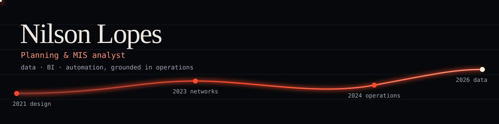
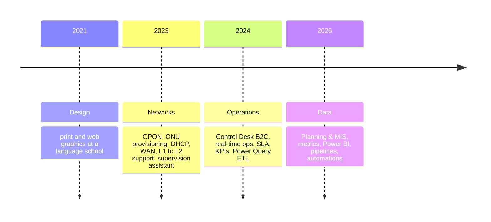
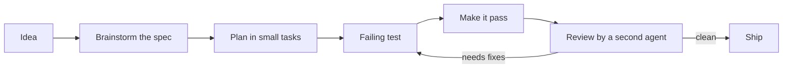

  

  
  
  

> I learned the network from the inside, then the operation, then the data behind it. That is why my dashboards get used: I have sat on the side of the desk that reads them.

### At a glance

| | |
|---|---|
| **Role** | Planning & MIS Analyst (Jr.) at Alloha Fibra |
| **Works on** | Business metrics, Power BI dashboards, data pipelines, automations, RPA and AI agents |
| **Languages** | Português, English (Cambridge PET), SQL, Python |
| **Superpower** | Turning "we update this by hand every morning" into "it refreshes itself" |
| **Believes** | A KPI nobody trusts is worse than no KPI. If it can run on a free tier, it should. |

### Where most of my work lives: Alloha Planejamento

The code belongs to the company and stays private, so each tool is told as a short story: what was broken, what I did, and what changed. The longer version, with an animated demonstration of each tool, is on the [portfolio site](https://jounimn.github.io/portfolio/#alloha).

<table>
<tr>
<td width="50%" valign="top">

#### Dispatch report collector
Report collector

Dispatch reports arrived scattered, and someone gathered and read them by hand every round. I started by mapping how each report arrives and what each reading needs to show. Then I wrote a collector that reads the files, standardizes the fields and puts everything in one place. Reading no longer depends on manual assembly: the team looks at organized data instead of preparing it.

</td>
<td width="50%" valign="top">

#### Reddir presentation refresh
Presentation automation

The follow-up presentation was rebuilt by hand at every update. I listed what changed each cycle and what stayed fixed, and separated the data source from the presentation layout. That made automation possible: the numbers go in and the presentation rebuilds itself. Updating stopped being a task of every cycle and now runs on its own.

</td>
</tr>
<tr>
<td width="50%" valign="top">

#### M code parameterizer
Power Query tool

In Power Query, every query had values locked into the code, and changing a source or a filter meant rewriting and checking everything by hand. I identified what changed from one query to the next, took those values out of the code and created named parameters. Then I built the tool that generates the M code from them. Changing a source became adjusting a parameter, with less rework and fewer typing errors.

</td>
<td width="50%" valign="top">

#### [Planning Intelligence](https://github.com/jounimn/website-analytics)
Data pipeline · public sample

Planning lived in a huge tree of spreadsheets, hard to trace and hard to reuse in analysis. I read the structure of the tree, defined what each level means, and built a versioned, provider-independent pipeline covered by tests, where every value comes out with its origin. The result is a structured dataset in which you can walk from the number back to the cell. The public sample is sanitized; names and data are fictional.

</td>
</tr>
</table>

**Side project: df-DnD** (on hold, private). A character-sheet app that keeps the rules of each D&D edition (AD&D 2e, 5e 2014 and 5e 2024) separate, so the math is right for whichever one the table plays, with a print-ready sheet. Built with Next.js and Supabase.

### The route so far

### Toolbox

  
  
  
  
  
  
  
  
  
  
  
  

<b>How I build</b>

 

I pair with AI agents the way I would pair with a senior dev: every change gets a plan first, a test second, code third, and a review before it merges.

<b>In the lab (private, for now)</b>

 

| Project | What it is |
|---|---|
| **Social Media Content Factory** | Provider-agnostic AI media generation (image, video, voice) orchestrated by n8n, with a provider registry, automatic fallback and scheduled health checks. The goal is zero or near-zero cost. |
| **Local business websites** | Conversion-focused sites for businesses in my region, with end-to-end tests, accessibility checks and LGPD-compliant privacy pages. |

  <b>Open to conversations about data, BI, automation and AI tooling.</b> 
  Best way to reach me: <a href="https://www.linkedin.com/in/nilsondgwm/">LinkedIn</a>

