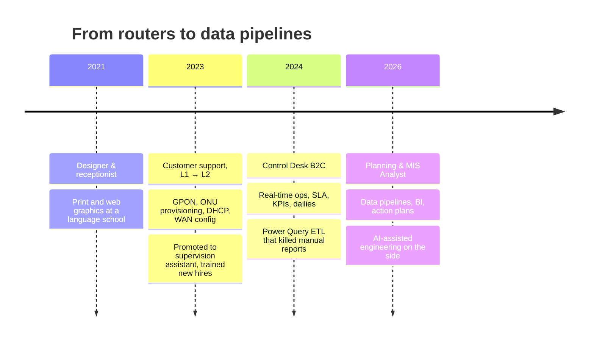
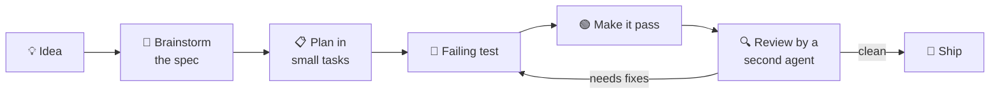

<!-- ░░░ HEADER ░░░ -->
<p align="center">
  
</p>

<p align="center">
<a href="https://git.io/typing-svg"></a>
</p>

<p align="center">
  <a href="https://www.linkedin.com/in/nilsondgwm/"></a>
  
  
</pre>

---

### `$ whoami`

```yaml
name:        Nilson Lopes
role:        Planning & MIS Analyst (Jr.) @ telecom / fiber ISP
based_in:    Carmo, Rio de Janeiro, Brazil 🇧🇷
speaks:      [Português, English (Cambridge PET), SQL, Python]
superpower:  turning "we update this by hand every morning" into "it refreshes itself"
believes:
  - "A KPI nobody trusts is worse than no KPI."
  - "A design opinion without a measurement is just a vibe."
  - "If it can run on a free tier, it should."
currently:
  day_job:   KPIs, dailies, ETL and action plans for a B2C operation
  side_quest: provider-agnostic AI media pipelines around n8n
```

---

### 🗺️ The journey so far



> I learned the network from the inside, then the operation, then the data behind it. That's why my dashboards get used: I've sat on the side of the desk that reads them.

---

### 🧪 Featured work

<table>
<tr>
<td width="50%" valign="top">

#### [📊 planning-intelligence](https://github.com/jounimn/website-analytics)
A versioned, provider-independent data pipeline that turns a sprawling spreadsheet planning tree into a **structured, traceable semantic dataset**.

A sanitized public sample. The code, tests and plans are real. The organization and data are fictional stand-ins.

`Python` · `ETL` · `Data Engineering` · `TDD`

</td>
<td width="50%" valign="top">

#### [🎨 df-design](https://github.com/jounimn/df-design)
A Claude Code skill for web design and motion, **built from 30 production sites** loaded in a real browser and measured.

The prober ships with it, so every number can be reproduced and every claim can be checked against any site you pick.

`JavaScript` · `Playwright` · `Claude Code Skills`

</td>
</tr>
</table>

<details>
<summary><b>🔬 In the lab (private, for now)</b></summary>
<br/>

| Project | What it is |
|---|---|
| 🏭 **Social Media Content Factory** | Provider-agnostic AI media generation (image, video, voice) orchestrated by n8n, with a provider registry, automatic fallback and scheduled health checks. The goal is zero or near-zero cost. |
| 🐉 **df-DnD** | A tabletop RPG character sheet app that respects the rules of each edition. It covers AD&D 2e through 5e 2024 and can print the sheet to paper. Built with Next.js, React and Tailwind. |
| 🌐 **Local business websites** | Conversion-focused sites for businesses in my region, with end-to-end tests, accessibility checks and LGPD-compliant privacy pages. |

</details>

---

### 🛠️ Toolbox

**Data & BI**

<p>
  
  
  
  
  
  
</p>

**Build & automate**

<p>
  
</p>
<p>
  
  
  
  
  
</p>

**Networks (where it all started)**

<p>
  
  
</p>

---

### ⚙️ How I build



> I pair with AI agents the way I'd pair with a senior dev: every change gets a plan first, a test second, code third, and a review before it merges.

---

### 📈 Stats

<p align="center">
  
</p>

<p align="center">
  
</p>

---

<p align="center">
  <b>Open to conversations about data, BI, automation and AI tooling.</b><br/>
  <sub>Best way to reach me: <a href="https://www.linkedin.com/in/nilsondgwm/">LinkedIn</a></sub>
</p>


