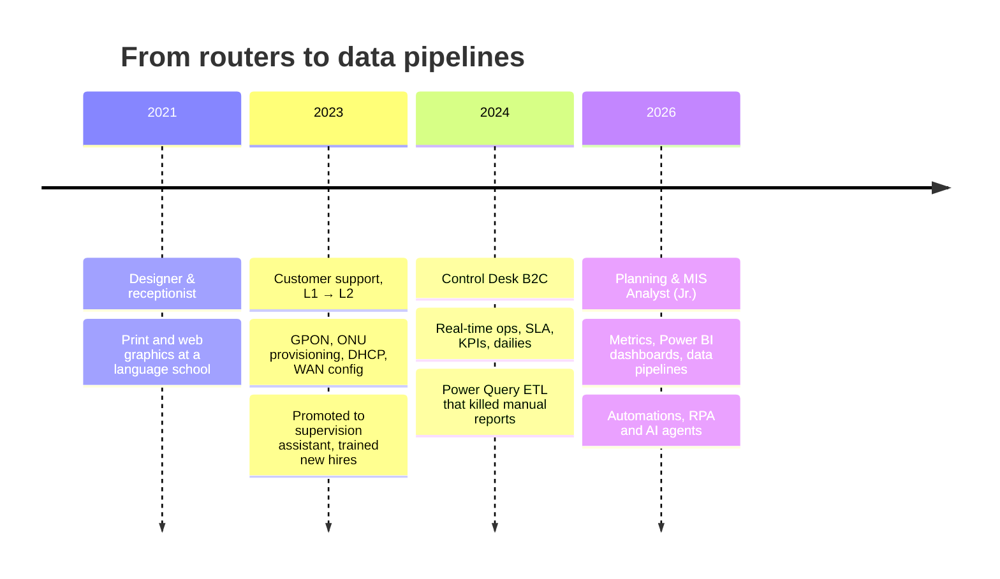
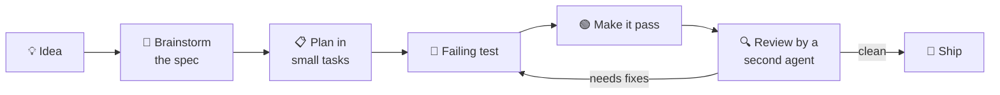

<!-- ░░░ HEADER ░░░ -->
<p align="center">
  
</p>

<p align="center">
<a href="https://git.io/typing-svg"></a>
</p>

<br> <br>

<p align="center">
  <a href="https://www.linkedin.com/in/nilsondgwm/"></a>
  <a href="https://jounimn.github.io/portfolio/"></a>
  
  
</p>

---

### `$ whoami`

```yaml
name:        Nilson Lopes
role:        Planning & MIS Analyst (Jr.) @ Alloha Fibra
based_in:    Carmo, Rio de Janeiro, Brazil 🇧🇷
speaks:      [Português, English (Cambridge PET), SQL, Python]
superpower:  turning "we update this by hand every morning" into "it refreshes itself"
believes:
  - "A KPI nobody trusts is worse than no KPI."
  - "If it can run on a free tier, it should."
currently:
  day_job:   business metrics, Power BI dashboards, data pipelines and automations
  also:      AI agents and RPA for routine work, with versioned and traceable code
```

---

### 🗺️ The journey so far



> I learned the network from the inside, then the operation, then the data behind it. That's why my dashboards get used: I've sat on the side of the desk that reads them.

---

### 🧪 Where most of my work lives: Alloha Planejamento

The code belongs to the company and stays private, so each tool is told as a short story: what was broken, what I did, and what changed. The full version, with an animated demonstration of each one, is on the [portfolio site](https://jounimn.github.io/portfolio/).

#### Dispatch report collector
Dispatch reports arrived scattered, and someone gathered and read them by hand every round. I started by mapping how each report arrives and what each reading needs to show. Then I wrote a collector that reads the files, standardizes the fields and puts everything in one place. Reading no longer depends on manual assembly: the team looks at organized data instead of preparing it.

#### Reddir presentation refresh
The follow-up presentation was rebuilt by hand at every update. I listed what changed each cycle and what stayed fixed, and separated the data source from the presentation layout. That made automation possible: the numbers go in and the presentation rebuilds itself. Updating stopped being a task of every cycle and now runs on its own.

#### M code parameterizer
In Power Query, every query had values locked into the code, and changing a source or a filter meant rewriting and checking everything by hand. I identified what changed from one query to the next, took those values out of the code and created named parameters. Then I built the tool that generates the M code from them. Changing a source became adjusting a parameter, with less rework and fewer typing errors.

#### [📊 Planning Intelligence](https://github.com/jounimn/website-analytics)
Planning lived in a huge tree of spreadsheets, hard to trace and hard to reuse in analysis. I read the structure of the tree, defined what each level means, and built a versioned, provider-independent pipeline covered by tests, where every value comes out with its origin. The result is a structured dataset in which you can walk from the number back to the cell. The public sample is sanitized; names and data are fictional.

`Python` · `ETL` · `Data Engineering` · `TDD`

### 🎲 Side project: df-DnD · on hold

A character-sheet app that keeps the rules of each D&D edition (AD&D 2e, 5e 2014 and 5e 2024) separate, so the math is right for whichever one the table plays, with a print-ready sheet. Built with Next.js and Supabase. The project is on hold and the code is private.

<details>
<summary><b>🔬 In the lab (private, for now)</b></summary>
<br/>

| Project | What it is |
|---|---|
| 🏭 **Social Media Content Factory** | Provider-agnostic AI media generation (image, video, voice) orchestrated by n8n, with a provider registry, automatic fallback and scheduled health checks. The goal is zero or near-zero cost. |
| 🌐 **Local business websites** | Conversion-focused sites for businesses in my region, with end-to-end tests, accessibility checks and LGPD-compliant privacy pages. |

</details>

---

### 🛠️ Toolbox

**Data & BI**

<p>
  
  
  
  
  
  
</p>

**Build & automate**

<p>
  
</p>
<p>
  
  
  
  
  
</p>

**Networks (where it all started)**

<p>
  
  
</p>

---

### ⚙️ How I build



> I pair with AI agents the way I'd pair with a senior dev: every change gets a plan first, a test second, code third, and a review before it merges.

---

### 📈 Stats

<p align="center">
  
</p>

<p align="center">
  
</p>

---

<p align="center">
  <b>Open to conversations about data, BI, automation and AI tooling.</b><br/>
  <sub>Best way to reach me: <a href="https://www.linkedin.com/in/nilsondgwm/">LinkedIn</a></sub>
</p>


